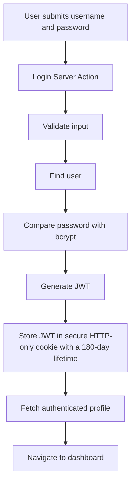

# Application Architecture

## Architecture Style

The application follows a **Feature-Based Architecture** built around the Next.js App Router and a **Server-Action-First data architecture**.

The codebase is organized primarily around business features rather than technical file types.

Each feature owns the code directly related to its domain.

Examples:

```text
auth
task
group
note
notification
trash
profile
settings
```

Each feature may contain:

```text
components/
hooks/
actions/
services/
types/
pages/
utils/
schemas/
models/
constants/
```

Not every feature is required to contain every directory.

Directories should only be created when they are actually needed.

---

# Critical Architecture Rule

## All CRUD Operations Must Use Server Actions

**Every internal CRUD operation in the application must be implemented using Next.js Server Actions.**

This rule applies without exception to application resources.

CRUD operations must **not** be implemented using:

```text
API Routes
Route Handlers
REST endpoints
Internal HTTP endpoints
```

For internal application CRUD operations, do not create handlers such as:

```text
POST /api/tasks
GET /api/tasks
PATCH /api/tasks/:id
DELETE /api/tasks/:id
```

Instead, use feature-specific Server Actions:

```text
createTask()
getTasks()
getTaskById()
updateTask()
trashTask()
restoreTask()
permanentlyDeleteTask()
```

This rule applies to:

```text
Tasks
Task Groups
Notes
Notifications
Profile
User Settings
Trash operations
Authentication-related mutations
Avatar operations where applicable
```

---

# CRUD Architecture

The required CRUD flow is:

```text
UI
 ↓
Feature Hook / Form
 ↓
Server Action
 ↓
Validation
 ↓
Authentication
 ↓
Authorization
 ↓
Feature Service
 ↓
Mongoose Model
 ↓
MongoDB
 ↓
Side Effects
 ↓
Cache Revalidation / Response
```

There must not be an internal API layer between the UI and Server Actions.

Incorrect:

```text
Client Component
      ↓
Axios
      ↓
/api/tasks
      ↓
Route Handler
      ↓
Database
```

Correct:

```text
Client Component
      ↓
Server Action
      ↓
Service
      ↓
Mongoose
      ↓
MongoDB
```

---

# Server Actions as Application Entry Points

Server Actions act as the primary application boundary for commands and internal data operations.

Example:

```ts
"use server";

export async function createTask(input: CreateTaskInput) {
  // validate
  // authenticate
  // authorize
  // execute business logic
  // persist data
  // create notification
  // revalidate affected data
  // return result
}
```

Server Actions must remain thin.

They are responsible for orchestration, not for containing all business logic.

Preferred architecture:

```text
Server Action
     ↓
Service
     ↓
Model
```

Not:

```text
Server Action
     ↓
Hundreds of lines of validation,
database queries,
business rules,
and side effects
```

---

# Server Action Responsibilities

A Server Action may be responsible for:

- Receiving input
- Validating input with Zod
- Authenticating the current user
- Performing authorization checks
- Calling feature services
- Triggering side effects
- Revalidating cache
- Returning a predictable result

Example:

```text
createTaskAction()
        ↓
validate createTaskSchema
        ↓
get authenticated user
        ↓
taskService.createTask()
        ↓
notificationService.createNotification()
        ↓
revalidate affected data
        ↓
return result
```

---

# Server Action Naming

Server Actions should have explicit names.

Examples:

```text
create-task.action.ts
get-tasks.action.ts
get-task.action.ts
update-task.action.ts
trash-task.action.ts
restore-task.action.ts
delete-task.action.ts
```

Example structure:

```text
features/
└── task/
    └── actions/
        ├── create-task.action.ts
        ├── get-tasks.action.ts
        ├── get-task.action.ts
        ├── update-task.action.ts
        ├── trash-task.action.ts
        ├── restore-task.action.ts
        └── delete-task.action.ts
```

The same convention should be used for other features.

---

# Reads Also Use Server Actions

The Server Action rule applies to every CRUD read as well as every mutation.

Examples:

```text
getTasks()
getTaskById()

getGroups()
getGroupById()

getNotes()
getNoteById()

getNotifications()

getTrashedItems()
```

Do not create internal GET API endpoints for these operations.

Server Components must invoke the appropriate Server Action for CRUD reads. They must not call CRUD services, repositories, or Mongoose models directly.

---

# Folder Structure

```text
/
├── app/
│   ├── (auth)/
│   │   ├── login/
│   │   │   └── page.tsx
│   │   │
│   │   └── register/
│   │       └── page.tsx
│   │
│   ├── (view)/
│   │   ├── layout.tsx
│   │   │
│   │   ├── dashboard/
│   │   │   └── page.tsx
│   │   │
│   │   ├── tasks/
│   │   │   ├── page.tsx
│   │   │   └── [taskId]/
│   │   │       └── edit/
│   │   │           └── page.tsx
│   │   │
│   │   ├── groups/
│   │   │   ├── page.tsx
│   │   │   └── [groupId]/
│   │   │       ├── page.tsx
│   │   │       └── edit/
│   │   │           └── page.tsx
│   │   │
│   │   ├── notes/
│   │   │   ├── page.tsx
│   │   │   └── [noteId]/
│   │   │       ├── page.tsx
│   │   │       └── edit/
│   │   │           └── page.tsx
│   │   │
│   │   ├── trash/
│   │   │   └── page.tsx
│   │   │
│   │   ├── notifications/
│   │   │   └── page.tsx
│   │   │
│   │   └── settings/
│   │       ├── page.tsx
│   │       ├── profile/
│   │       │   └── page.tsx
│   │       ├── account/
│   │       │   └── page.tsx
│   │       └── appearance/
│   │           └── page.tsx
│   │
│   ├── layout.tsx
│   ├── loading.tsx
│   ├── error.tsx
│   ├── not-found.tsx
│   └── globals.css
│
├── features/
│   ├── auth/
│   ├── task/
│   ├── group/
│   ├── note/
│   ├── notification/
│   ├── trash/
│   ├── profile/
│   └── settings/
│
├── components/
│   ├── ui/
│   └── shared/
│
├── hooks/
├── services/
├── types/
├── utils/
├── constants/
├── lib/
├── public/
├── middleware.ts
└── ...
```

Route Handlers under `/app/api` must not implement internal CRUD operations.

---

# API Route Policy

Route Handlers are not part of the application's internal CRUD architecture.

Do not use Route Handlers for:

```text
Creating tasks
Reading tasks
Updating tasks
Deleting tasks

Creating groups
Reading groups
Updating groups
Deleting groups

Creating notes
Reading notes
Updating notes
Deleting notes

Profile CRUD
Notification CRUD
Settings CRUD
Trash CRUD
```

Server Actions must handle these operations.

---

# When Route Handlers May Be Used

Route Handlers may only be introduced for non-CRUD requirements that genuinely require an HTTP endpoint.

Examples may include:

```text
Third-party webhooks
External service callbacks
Public machine-to-machine endpoints
OAuth provider callbacks when required
External integrations that cannot invoke Server Actions
```

They must never perform internal CRUD or be introduced as an alternative CRUD boundary. Every internal CRUD operation triggered by the application must enter through a Server Action.

---

# Feature Structure

Example Task feature:

```text
features/
└── task/
    ├── actions/
    │   ├── create-task.action.ts
    │   ├── get-tasks.action.ts
    │   ├── get-task.action.ts
    │   ├── update-task.action.ts
    │   ├── trash-task.action.ts
    │   ├── restore-task.action.ts
    │   └── delete-task.action.ts
    │
    ├── components/
    │   ├── task-card.tsx
    │   ├── task-list.tsx
    │   ├── task-details-drawer.tsx
    │   ├── task-creation-dialog.tsx
    │   └── task-filters.tsx
    │
    ├── hooks/
    │   ├── use-tasks.ts
    │   ├── use-create-task.ts
    │   └── use-update-task.ts
    │
    ├── models/
    │   └── task.model.ts
    │
    ├── pages/
    │   └── tasks-page.tsx
    │
    ├── schemas/
    │   └── task.schema.ts
    │
    ├── services/
    │   └── task.service.ts
    │
    ├── types/
    │   └── task.types.ts
    │
    ├── utils/
    │   └── task.utils.ts
    │
    └── constants/
        └── task.constants.ts
```

---

# Feature Responsibilities

## Components

Feature-specific user interface.

Examples:

```text
TaskCard
TaskList
TaskForm
TaskFilters
TaskDetailsDrawer
```

Task details open from a task row or card in the shared components/ui/drawer.tsx component, following the approved Figma Tasks Details drawer frame (8:2169). Do not create a standalone task details route or page. Load the selected task with getTaskById() and enforce the usual ownership checks.

Task editing reuses the task creation dialog in edit mode, prefilled from the selected task and submitted through the authorized update action. Do not create a separate `/edit` route or page.

---

## Hooks

Client-side reusable feature logic.

Hooks may integrate with:

```text
React Query
React Hook Form
use-debounce
Browser APIs
```

Example:

```ts
const mutation = useMutation({
  mutationFn: createTask,
});
```

Here `createTask` is a Server Action rather than an Axios request to an internal API endpoint.

---

# Actions

Actions are the server-side entry points for CRUD operations.

Every CRUD feature must expose the necessary Server Actions.

Examples:

```text
Task Actions
Group Actions
Note Actions
Notification Actions
Profile Actions
Settings Actions
Trash Actions
```

Typical flow:

```text
Server Action
      ↓
Zod Validation
      ↓
Authentication
      ↓
Authorization
      ↓
Service
      ↓
Database
      ↓
Notification / Side Effects
      ↓
Revalidation
      ↓
Result
```

---

# Services

Services contain reusable business logic and database-oriented workflows.

Example:

```text
task.service.ts
```

Possible responsibilities:

```text
Create task
Find task
Update task
Check ownership
Move task to trash
Restore task
Delete task permanently
```

Services must not contain presentation logic.

---

# Models

Mongoose models belong to their corresponding features.

```text
features/task/models/task.model.ts
features/group/models/group.model.ts
features/note/models/note.model.ts
```

Mongoose models are server-only.

They must never be imported into Client Components.

---

# Schemas

Zod schemas should be colocated with their corresponding feature.

They may validate:

```text
Server Action inputs
Forms
Search parameters
Filters
Database-related input
```

---

# Pages

Feature `pages/` directories do not define Next.js routes.

Routes remain inside:

```text
app/
```

For example:

```tsx
import { TasksPage } from "@/features/task/pages/tasks-page";

export default function Page() {
  return <TasksPage />;
}
```

---

# Data Flow

## Client Mutation Flow

```text
Client Component
      ↓
Feature Hook
      ↓
React Query Mutation
      ↓
Server Action
      ↓
Zod Validation
      ↓
Authentication
      ↓
Authorization
      ↓
Service
      ↓
Mongoose
      ↓
MongoDB
      ↓
Notification / Side Effects
      ↓
Revalidation
      ↓
Mutation Result
      ↓
React Query Cache Update
      ↓
UI
```

There is no internal REST API layer.

---

# Server Component Read Flow

For server-rendered data:

```text
Server Component
      ↓
Server Action
      ↓
Authentication
      ↓
Authorization
      ↓
Mongoose
      ↓
MongoDB
      ↓
Server-rendered UI
```

Do not make an HTTP request from the Next.js server back into the same Next.js application merely to retrieve internal data.

Incorrect:

```text
Server Component
      ↓
fetch("/api/tasks")
```

Preferred:

```text
Server Component
      ↓
getTasks()
```

Here, `getTasks()` is a Server Action. It may delegate its implementation to a service, but the Server Component must not call that service directly.

---

# Axios Policy

Axios must **not** be used to communicate with internal CRUD endpoints because internal CRUD endpoints do not exist.

Axios may still be used for:

```text
External APIs
Third-party services
External integrations
Services requiring HTTP communication
```

Do not use:

```ts
axios.post("/api/tasks");
axios.patch("/api/tasks/123");
axios.delete("/api/tasks/123");
```

Use:

```ts
await createTask(input);
await updateTask(input);
await permanentlyDeleteTask(taskId);
```

instead.

---

# React Query Architecture

React Query may still be used for client-side server-state management.

Server Actions can be used directly as React Query query or mutation functions where appropriate.

Example:

```ts
const createTaskMutation = useMutation({
  mutationFn: createTask,
  onSuccess: () => {
    queryClient.invalidateQueries({
      queryKey: taskKeys.lists(),
    });
  },
});
```

React Query responsibilities include:

```text
Client-side caching
Pending states
Mutation states
Cache invalidation
Optimistic updates
Background synchronization
```

React Query must not introduce an API Route dependency.

---

# Authentication Flow



Authentication mutations such as:

```text
register
login
logout
changePassword
updateProfile
```

should also use Server Actions.

---

# Authorization

Every Server Action must independently enforce authorization for protected operations.

Never assume that because a page is protected, its Server Actions are automatically safe.

For example:

```text
updateTask(taskId)
      ↓
Get authenticated user
      ↓
Find task
      ↓
Verify task.userId === user.id
      ↓
Update task
```

Never trust:

```text
userId from client
task owner from client
group owner from client
URL parameters
form fields
client state
```

as authorization evidence.

---

# Notification Architecture

Successful CRUD operations should generate notifications where required.

Example:

```text
createTask()
      ↓
Task successfully persisted
      ↓
Create notification
      ↓
Revalidate affected data
      ↓
Return success
```

The notification must not be created before the primary operation succeeds.

---

# Cache Revalidation

Server Actions are responsible for triggering appropriate cache updates after mutations where required.

Possible mechanisms include:

```text
revalidatePath()
revalidateTag()
React Query invalidation
```

Use the smallest appropriate invalidation scope.

Example:

```text
Create Task
   ↓
Revalidate task list
   ↓
Revalidate dashboard statistics
```

Do not invalidate unrelated application data.

---

# Server-First Architecture

Use Server Components by default.

Only introduce `"use client"` when required for:

```text
useState
useEffect
React Query
React Hook Form
DOM events
Browser APIs
Interactive UI
```

Keep client boundaries as small as possible.

---

# Performance

Server Actions contribute to the server-first architecture by eliminating unnecessary internal HTTP layers.

Avoid:

```text
Client
 ↓
API Route
 ↓
Service
 ↓
Database
```

Use:

```text
Client
 ↓
Server Action
 ↓
Service
 ↓
Database
```

This keeps application flows explicit and reduces unnecessary boilerplate.

Other performance principles include:

- Prefer Server Components.
- Minimize Client Components.
- Dynamically import heavy client components.
- Debounce search operations.
- Paginate large collections.
- Index MongoDB based on actual query patterns.
- Select only required database fields.
- Avoid unnecessary Mongoose population.
- Avoid unnecessary React Query invalidation.
- Optimize user-uploaded images.
- Use `next/image` where appropriate.

---

# Clean Code

Keep responsibilities explicit.

Example:

```text
task-creation-dialog.tsx
→ UI

create-task.action.ts
→ server entry point

task.schema.ts
→ input validation

task.service.ts
→ business logic

task.model.ts
→ persistence

use-create-task.ts
→ client mutation behavior
```

Do not merge these responsibilities into a single large file.

---

# SOLID Principles

SOLID principles should guide architecture where useful without introducing unnecessary abstractions.

Particularly important:

### Single Responsibility

Each module has a clear responsibility.

### Open / Closed

Features should support extension without requiring major rewrites.

### Interface Segregation

Prefer focused input types:

```text
CreateTaskInput
UpdateTaskInput
TaskFilters
```

### Dependency Inversion

Business logic should avoid unnecessary coupling to infrastructure.

---

# Image Optimization

Use Next.js Image when appropriate:

```tsx
import Image from "next/image";
```

Uploaded avatars should:

- Restrict MIME types.
- Restrict maximum file size.
- Be validated server-side.
- Be resized when necessary.
- Avoid serving unnecessarily large originals.
- Prefer optimized image formats.

UploadThing is the required file-upload and storage provider for avatars. UploadThing transport endpoints are external integration infrastructure; all internal avatar-reference CRUD must still enter through Server Actions.

Avatar modifications should be initiated using Server Actions.

---

# Security Rules

- All CRUD uses Server Actions.
- Every protected Server Action performs authentication.
- Every resource operation verifies ownership.
- All external input is validated.
- Passwords are hashed.
- JWT secrets remain server-side.
- JWT must use secure HTTP-only cookies with a 180-day lifetime.
- Mongoose remains server-only.
- Never trust client-provided user IDs.
- Validate uploaded files server-side.
- Sanitize rich-text output when necessary.
- Do not expose internal errors or stack traces.
- Validate active sessions and session revocation for every protected operation.
- Enforce workspace membership and role permissions in every collaborative Server Action.
- Rate-limit authentication and recovery operations.
- Keep two-factor secrets, invitation tokens, reset tokens, and session tokens server-only.

---

# Background Work Architecture

Recurring tasks, reminders, push delivery, Trash retention, orphan-file cleanup, scheduled backups, and report aggregation require scheduled or asynchronous work.

```text
Scheduler / Worker
        ↓
Authenticated System Server Action
        ↓
Validation and Idempotency Check
        ↓
Feature Service
        ↓
MongoDB / UploadThing / Push Provider
```

Background infrastructure must not write application resources directly. It must invoke dedicated system-authorized Server Actions so the Server Action CRUD boundary remains intact.

Every scheduled operation must be idempotent, record failures, and support safe retry.

---

# Search Architecture

Global search must use an authenticated Server Action. The action validates scope and ownership before searching private or workspace resources.

MongoDB text indexes may support the initial implementation. MongoDB Atlas Search may be introduced for autocomplete, highlighting, faceting, and more advanced relevance without changing the Server Action entry point.

Recent-search CRUD and saved-filter CRUD must also use Server Actions.

---

# Attachment Architecture

UploadThing handles binary transfer and storage. Application metadata remains in MongoDB.

```text
Authenticated User
        ↓
UploadThing File Route Authentication
        ↓
UploadThing Storage
        ↓
Attachment Server Action
        ↓
Attachment Metadata in MongoDB
```

Attachment Server Actions must validate resource ownership or workspace permissions. Removing or replacing an attachment must delete the UploadThing file and database reference safely. Cleanup work must detect uploads that completed without a corresponding attachment record.

---

# Session and Account Security Architecture

JWTs must identify a persisted session. Protected Server Actions validate the JWT, session state, expiration, user session version, and authorization.

Revoking a session invalidates that device. Changing a password or choosing Logout All Devices increments the session version and revokes other sessions. Email verification, password reset, invitations, and two-factor challenges use hashed, expiring, single-use tokens.

---

# Collaboration Architecture

Private resources use `userId`. Shared resources use both their creator or owner identity and `workspaceId`.

Every collaborative Server Action must:

1. Authenticate the user.
2. Load active workspace membership.
3. Verify the required role.
4. Validate ownership and workspace consistency for related resources.
5. Perform the operation through the feature service.
6. Record an activity event after success.
7. Revalidate affected data and publish a real-time update.

MongoDB change streams may broadcast committed changes to connected clients. They must not become a CRUD entry point.

---

# Push and PWA Architecture

Push-subscription CRUD uses Server Actions. A service worker receives push messages and displays notifications when permission has been granted.

Reminder delivery must tolerate expired subscriptions, remove invalid endpoints, respect user timezone, and avoid duplicate delivery through an idempotency key.

---

# Data Portability and Recovery Architecture

Exports must be generated from authorized Server Actions and must omit secrets, password hashes, token hashes, and internal security metadata.

Imports must use a validate-preview-confirm flow. The final import Server Action validates ownership, detects duplicates, and applies changes in bounded batches.

Backup restoration is an administrative operation with documented verification and rollback procedures. User-facing Undo must use explicit compensating Server Actions rather than database state manipulation from the client.

---

# Future Architecture

The application may later evolve beyond the currently required collaboration, background processing, search, push, and reporting capabilities to support:

```text
Message queues
Caching layers
Observability
More advanced domain boundaries
Event-driven communication
```

These future additions must **not replace or bypass the Server Action rule for internal application CRUD.**

For example, introducing Redis or an event system may change what happens after:

```text
createTask()
```

but the entry point for every internal CRUD operation must remain:

```text
UI
 ↓
Server Action
```

rather than:

```text
UI
 ↓
Internal REST API
```

---

# Architecture Decision Rule

Current requirements should always prefer the simplest correct architecture.

```text
Current Requirement
       ↓
Server Action
       ↓
Feature Service
       ↓
Persistence / Infrastructure
       ↓
Measure
       ↓
Evolve only when necessary
```

Avoid:

```text
Unnecessary API Routes
Premature REST architecture
Premature microservices
Premature repositories
Premature caching
Premature event systems
Speculative abstraction
```

The project should remain simple, explicit, strongly typed, secure, and easy to extend.
